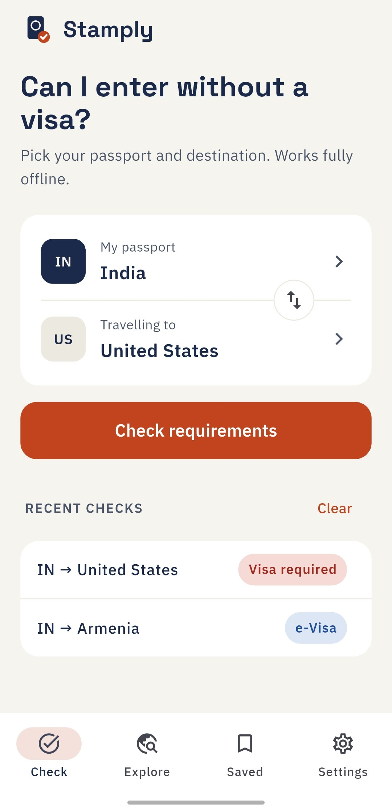
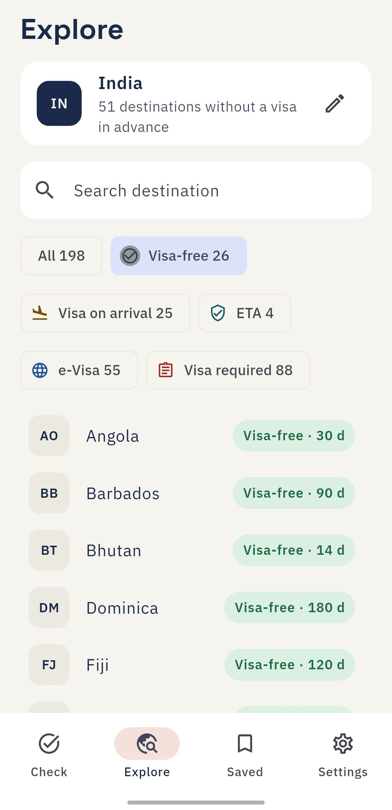
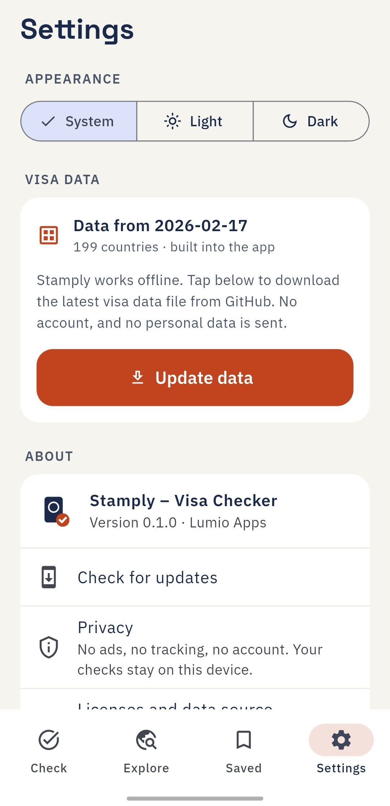
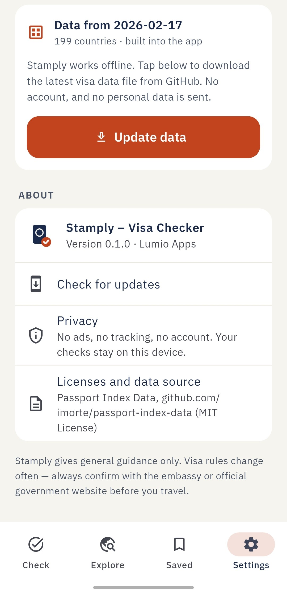

<div align="center">


# Stamply – Visa Checker

**Do I need a visa? Find out in seconds — even offline.**

Visa and entry requirements for **199 passports** to every destination.
Visa-free, visa on arrival, ETA, e-Visa or visa required — with the allowed stay where it is known.

No ads. No tracking. No account. Free and open source.

[](https://github.com/lumio-apps/stamply/releases/latest)
[](LICENSE)


</div>

## Screenshots

<p align="center">
  
  
  
  
</p>

## Features

### ✅ Check
- Pick your **passport** and **destination** from a searchable list of 199 countries
- **Swap** them with one tap
- Country **flags** everywhere
- Clear result card styled like a passport stamp
- **Share** the result as a picture (WhatsApp, Instagram, anywhere)
- **Allowed stay** in days, where available
- **Before you fly** tips: return ticket, proof of funds, and a warning about fake e-Visa websites
- **Passport expiry check**: add your expiry date and see if you meet the common 6-month rule
- **Recent checks** with their status at a glance

### 🛂 Passports
- **Passport power**: how many destinations you reach without a visa in advance, and your **rank** among 199 passports
- **World ranking** of all passports
- **Second passport** for dual citizens: switch with one tap, and the result tells you when your other passport is easier
- **Compare two passports** side by side and see exactly where their rules differ

### 🧳 Trips
- **Trip planner**: add several countries to one trip and see the rule for each, plus how many need something before you fly
- **Schengen 90/180 calculator**: add past and planned stays, see days used and left, when a day frees up, and how long you can stay if you enter on a given date. Works fully offline
- Add a country to your trip from any result screen
- Share the whole trip as text

### 🌐 20 languages
- English, हिन्दी, বাংলা, ગુજરાતી, ಕನ್ನಡ, മലയാളം, मराठी, ਪੰਜਾਬੀ, தமிழ், తెలుగు, اردو, العربية, 中文, 日本語, Español, Français, Português, Русский, Bahasa Indonesia, Հայերեն
- **Country names** are translated too, so you can search in your own language
- Right-to-left layout for Arabic and Urdu
- A first-launch **welcome screen** to pick your language and passport

### 🌍 Explore
- Every destination for your passport in one list
- See how many countries you can visit **without a visa in advance**
- Filter by status: Visa-free, Visa on arrival, ETA, e-Visa, Visa required
- Search any destination

### 🔖 Saved
- Bookmark trips from the result screen
- A **Changed** badge appears when a data update changes the rule for a saved trip
- Swipe to remove

### ⚙️ Settings
- Passport expiry date (stays on your device), with optional **expiry reminders** 6, 3 and 1 month before (Android, set on the device with no extra service)
- **Language** picker (20 languages)
- Light, dark or system theme
- **Update data**: download the latest visa data with one tap
- In-app **Check for updates** (GitHub APK)

## How the data works

| | |
| --- | --- |
| **Built in** | All visa data ships inside the app, so Stamply works with no internet at all — even at the airport. |
| **Optional update** | **Settings → Update data** downloads one static file, [`assets/data/visa_data.json`](assets/data/visa_data.json), from this repository. No server, no account, no personal data sent. |
| **Monthly refresh** | A GitHub Action ([`update-data.yml`](.github/workflows/update-data.yml)) rebuilds the file from the open [Passport Index Data](https://github.com/imorte/passport-index-data) on the 1st of every month. |

Rebuild the data by hand:

```bash
python3 tool/build_data.py
```

> [!IMPORTANT]
> Stamply gives **general guidance only**. Visa rules change often. Always confirm with the embassy or the official government website of your destination before you travel.

## Privacy

- ❌ No ads
- ❌ No analytics, crash reporting or tracking
- ❌ No account or sign-in
- ✅ Your passport, saved trips and recent checks stay on your device
- 🌐 Internet is used **only** when you tap **Update data** or **Check for updates**

Full policy: [PRIVACY.md](PRIVACY.md)

## Download

Get the latest build from **[Releases](https://github.com/lumio-apps/stamply/releases/latest)**:

- **Android**: `Stamply-<version>.apk`
- **Windows 10/11**: `Stamply-<version>-windows.zip`. Unzip it and run `stamply.exe`. No installer, no admin rights needed.

An **F-Droid** version is planned. Stamply is distributed only through GitHub and F-Droid, never through Google Play.

## Windows

The same app runs on Windows with the same offline data. Sharing a result copies the text and opens the picture in your image viewer. The in-app updater is Android only; on Windows, download the new zip from Releases.

```
flutter create --platforms=windows .   # once, creates the windows/ folder
flutter run -d windows
flutter build windows --release
```

## Translations

Texts live in `lib/l10n/app_<code>.arb`; `app_en.arb` is the template. To fix or add a translation, edit the matching `.arb` file and open a pull request. `flutter pub get` regenerates the Dart code.

## Build from source

Requirements: [Flutter](https://flutter.dev) (stable channel) and Java 17.

```bash
git clone https://github.com/lumio-apps/stamply.git
cd stamply
flutter pub get
flutter analyze
flutter build apk --release
```

F-Droid build (without the in-app updater, as F-Droid updates apps itself):

```bash
flutter build apk --release --dart-define=SELF_UPDATE=false
```

### Releases

Pushing a version tag (for example `v0.1.0`) makes GitHub Actions build, sign and publish the APK.

Required repository secrets: `KEYSTORE_BASE64`, `KEYSTORE_PASSWORD`, `KEY_ALIAS`, `KEY_PASSWORD`.

## Project structure

```
lib/
├── main.dart               App entry and bottom navigation
├── l10n/                   20 translation files (.arb) and the language list
├── status_text.dart        Translated texts for statuses and rules
├── theme.dart              Colors, fonts, light and dark themes
├── passport_validity.dart  Passport expiry and the 6-month rule
├── schengen.dart           Schengen 90/180-day maths
├── reminder_service.dart   Passport expiry reminders (Android)
├── share.dart              Share sheet bridge (text and image)
├── models.dart             Entry status, visa rule, trip
├── visa_repository.dart    Bundled data + optional download
├── app_state.dart          Saved trips, recent checks, settings
├── update_service.dart     In-app updater (GitHub APK)
├── widgets.dart            Shared UI pieces and the logo
└── pages/                  Check, Explore, Saved, Settings, Result, Trip, Schengen, Ranking, Compare
tool/build_data.py          Builds visa_data.json from Passport Index Data
assets/data/country_names.json  Country names in 19 languages (Unicode CLDR)
```

## Credits

- Visa data: [Passport Index Data](https://github.com/imorte/passport-index-data), MIT License
- Country names: [Unicode CLDR](https://cldr.unicode.org/), Unicode License v3
- Fonts: [Space Grotesk](https://github.com/floriankarsten/space-grotesk) and [IBM Plex Sans](https://github.com/IBM/plex), SIL Open Font License

## More from Lumio Apps

Privacy-first apps with no ads and no tracking: [lumio-apps.online](https://lumio-apps.online) · [GitHub](https://github.com/lumio-apps)

## License

[MIT](LICENSE) © Lumio Apps
